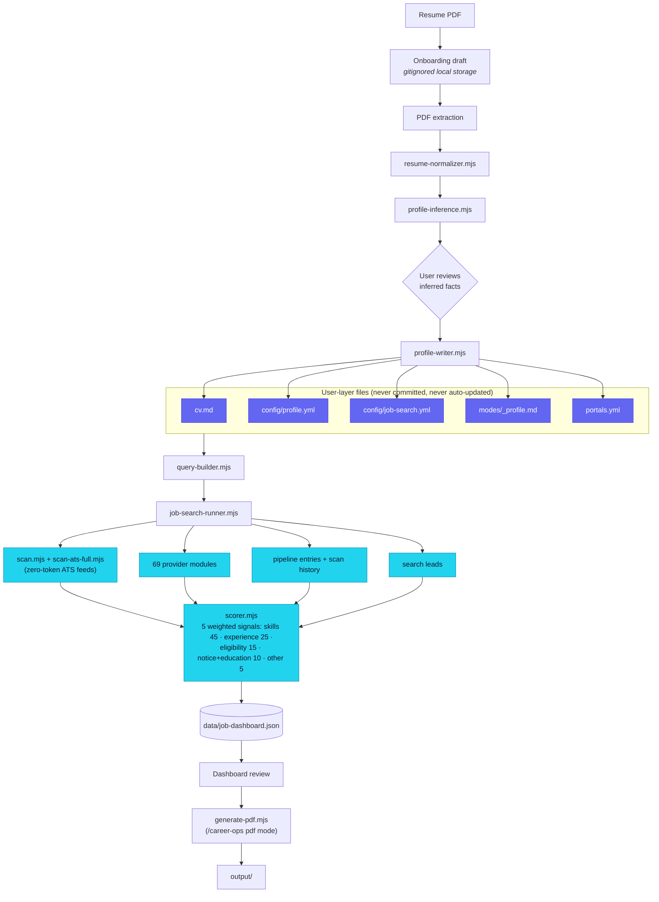

<div align="center">


**Local-first career intelligence — evidence-backed scoring, not spray-and-pray.**

---


</div>

---

## What Is This

HireSignal is a focused career dashboard built on top of the open-source [career-ops](https://github.com/santifer/career-ops) project by Santiago Fernandez de Valderrama.

career-ops provides the foundation: the job-search pipeline, AI-agent workflow, scanner architecture, tracker conventions, PDF generation flow, liveness checks, and the philosophy of quality applications over spray-and-pray automation.

HireSignal extends that foundation with a **local web dashboard** that helps a candidate:

- upload and review a resume locally
- convert resume evidence into a structured search profile
- discover jobs from ATS feeds, configured sources, remote boards, and search leads
- score opportunities against candidate facts instead of shallow title matching
- keep career-ops compatibility for scans, reports, trackers, modes, and templates

> **The intent is simple: fewer random applications, more informed decisions.**

### The dashboard

HireSignal ships one dashboard over your local data and engine: `web/` — Next.js
16 · React 19 · TypeScript 7 · Tailwind 4 (SSR/App Router), with multi-profile
routing (`?profile=slug` registry + switcher), in-process scoring, and a full
surface (Today command center · Board · Pipeline · Ops · Intel · Portals ·
Analytics · CV · Onboarding · ⌘K palette). **This README's "modern dashboard"
notes describe `web/`.**

---

## Why HireSignal Exists

Most job tools either track applications after the fact or encourage volume. HireSignal is designed for the earlier decision point: **should this role deserve your attention at all?**

It treats your resume and preferences as the source of truth, then searches and ranks opportunities by signals that matter:

| Signal | What it gates |
|--------|--------------|
| Demonstrated skills | Direct evidence from your CV |
| Adjacent & excluded skills | Avoid roles you'd hate or underqualify for |
| Experience range | Seniority match — not just title match |
| Location & remote eligibility | Automatically applied to every result |
| Compensation gates | Flags anything below your target range |
| Joining availability | Matched against notice-period language in postings |
| Candidate-controlled preferences | Your call, not the algorithm's |

**It does not submit applications. It helps you decide what is worth applying to.**

---

## Features

| Feature | What it does |
|---------|-------------|
| Local resume onboarding | Upload a PDF resume, extract text locally, and review inferred profile facts before activation |
| Evidence-backed profile review | Converts resume sections into editable candidate facts: target roles, skills, seniority, location policy, and compensation preferences |
| Profile-driven search | Builds discovery queries from candidate facts, combining ATS providers, remote feeds, configured portals, scan history, and pipeline entries |
| Fit scoring | Scores roles using skills, experience, eligibility, compensation, availability, and preferences — not title-only matching |
| Portfolio site generator | Builds a personal portfolio **website** from a candidate's own career-ops data (identity, CV, storybank, proof points, pipeline) — role-agnostic, themeable, exportable as a standalone Vite project. See [`docs/PORTFOLIO.md`](docs/PORTFOLIO.md). |
| Privacy audit | Verifies local dashboard code does not leak private resume/profile data into system-layer files |
| career-ops compatibility | Keeps core tracker files, reports, scanner scripts, modes, templates, and data contract available |
| Bot-block-aware liveness | Distinguishes a bot-blocked-but-live posting from a genuinely dead one (per-domain block signatures for LinkedIn, naukri, foundit, instahyre, cutshort) so blocked postings are never misrecorded as expired — see [`docs/liveness-bot-block-policy.md`](docs/liveness-bot-block-policy.md) |
| Board maintenance | `board-sweep.mjs` re-checks liveness for every open pipeline entry (zero-token ATS API by default, `--browser` for full checks) and `board-clean.mjs` purges non-Android false positives from `data/pipeline.md` |

---

## The 2.0 Dashboard (`web/`)

A single, profile-aware command center over your local career-ops data. Every
view reads (and edits) the **active profile's** files; switching profiles
re-scopes the whole app.

### Multi-profile

One checkout can host several candidates. A `profiles.yml` registry maps a slug
to a data root; the app resolves it per request (`?profile=slug`, made sticky by
a cookie). A sidebar/mobile **switcher** lists profiles and can **create** a new
one. With no registry, the app behaves exactly as a single-profile install.

```yaml
# profiles.yml (gitignored — private)
profiles:
  - name: alice
    display_name: Alice A
    root: profiles/alice      # relative to the data root
    color: "#dd7627"
```

`node migrate-profile.mjs <slug> --display-name "Name"` migrates an existing
single-profile install into a named profile (copy-by-default, idempotent,
`--dry-run`). See [`docs/MULTI_PROFILE.md`](docs/MULTI_PROFILE.md).

### Surfaces

| View | What it does |
|------|-------------|
| **Today** | A command center: KPI hero (interviews / actions due / decisions awaiting), a "needs action today" follow-up queue, an interview snapshot (active loops + drills + recent outcomes), a job-board snapshot, and a coaching callout — all from your real data, self-hiding when empty. |
| **Board** | The scored job board over the cached feed: score-distribution donut, score tabs (All / Good+ / Strong+ / Excellent), section tabs (Recommended / Review / Sources), a "previously-rejected" filter, per-card **Evaluate** + an expandable detail (eligibility, comp, years, reasons, matched / supporting / learning / gap skills), optional group-by-company, and **Run search** (a real ATS/feed crawl streamed with a 4-stage progress animation). CSV export. |
| **Pipeline** | The application tracker + inbox: inline status dropdown, click-to-edit notes, an inbox done-checkbox, a status funnel mini-viz, sorting/filtering, and per-row links to the evaluation report. |
| **Ops** | Operations + discovery: run scan / scan+verify / liveness / pipeline-health (the real `.mjs`), an ad-hoc liveness URL check, the agent inbox (queue / remove / quick-tasks), the career-ops + interview-coach command grids, tracked companies + queries, and the full scan-history table. |
| **Intel** | Interview coaching: a profile banner (target comp / archetypes / superpowers + a live health check), storybank (STAR expansion), outcome log, question bank, company patterns, drills, follow-up cadence, rejection-pattern analysis, and a collapsible CV viewer. |
| **Onboarding** | Resume → profile: **upload a PDF** (or paste text) → the real inference engine drafts your targets/skills/seniority → a multi-step review wizard → activate (writes the canonical user files, archiving any existing ones first). |
| **⌘K palette** | One control surface: navigate anywhere, run real ops (search / scan / health / liveness), and copy career-ops / interview-coach CLI commands. |
| Portals · Analytics · CV | Tracked-company health, the outcome funnel + score distribution, and the canonical CV. |

### Under the hood

- **Scoring as a library** — the pure A–G scoring functions run **in-process**
  (no subprocess), so a web evaluation is byte-identical to a CLI one. Exposed at
  `/api/jobs/{score,search-plan,cache,refresh,export}`.
- **Engine, not reimplementation** — long-running work (job search, onboarding,
  scans, follow-up cadence, pattern analysis) spawns the **real** career-ops
  `.mjs`, scoped to the active profile via `CAREER_OPS_ROOT`, streaming progress.
- **Data contract intact** — the web app is read-only over your data except the
  sanctioned writes (profile edits, the managed memory block in
  `modes/_profile.md`, and onboarding activation, which archives before writing).

---

## Quick Start

### The 2.0 dashboard (`web/`, recommended)

```bash
# from the repo root
npm install                 # engine deps (scanner, providers, pdf, …)

cd web
npm install                 # dashboard deps
npm run dev                 # Next.js dev server → http://localhost:3000
# or: npm run build && npm start   (production)
```

In development, point the app at your real data with `CAREER_OPS_ROOT`
(otherwise it reads the parent checkout):

```bash
cd web
CAREER_OPS_ROOT=/path/to/your/career-ops npm run dev
```

`npm run typecheck` and `npm run build` validate the app. A throwaway build dir is
available via `BUILD_DIST=.next-prod npm run build` (won't clobber a live dev `.next`).

The dashboard guides you through: upload a resume PDF → review the extracted
evidence → activate a local profile → run a first job search → review ranked
opportunities.

### Desktop shell (early)

`desktop/` wraps the same Next.js dashboard in an Electron window (v0.1.0 —
an early scaffold, not yet a signed installer):

```bash
cd desktop
npm install
npm run build:web   # builds web/ first
npm run dev          # launches the Electron shell
# npm run package     # electron-builder, unsigned local build
```

User data stays in the OS's writable app-data folder by default; it still
shells out to whatever AI CLI is on `PATH`. See [`desktop/README.md`](desktop/README.md)
for the packaging details.

---

## Commands

```bash
# 2.0 dashboard (from web/)
cd web && npm run dev       # Next.js dev server (http://localhost:3000)
cd web && npm run build     # production build  ·  npm start to serve
cd web && npm run typecheck # tsc --noEmit

# engine (from the repo root)
npm run doctor              # Check required career-ops setup files
npm run audit:private-data  # Check private-data boundaries
npm run scan                # Run the zero-token career-ops scanner
npm run scan:full           # Reverse-discover jobs from public ATS APIs
npm run tracker             # Open the career-ops tracker
npm run pdf                 # Generate a career-ops PDF resume
npm run board:sweep         # Liveness-sweep every open pipeline.md entry (--browser, --mark)
npm run board:clean         # Purge non-Android false positives from pipeline.md (--apply)

# multi-profile
node migrate-profile.mjs <slug> --display-name "Name" [--dry-run]
```

This is a curated subset — the engine ships 40+ `npm run` scripts plus several
`node`-only ones. See [`docs/SCRIPTS.md`](docs/SCRIPTS.md) for the full reference.

---

## Architecture



Private candidate data stays in the local user layer throughout (indigo nodes above). System-layer code and public docs never contain real resume details, salary targets, or application history.

---

## Project Structure

```text
web/                      The dashboard (Next.js 16 / React 19 / TS 7 / Tailwind 4)
  src/app/                App Router pages + API routes (/api/jobs, /api/onboarding, …)
  src/components/         board · home · ops · intel · onboarding · ui · command palette
  src/lib/                profile-registry · career-ops readers · jobs/scoring · coach …
    onboarding/           onboarding engine (profile-inference, profile-writer, resume-*, pdf-layout)
    scoring/  search/     canonical scorer + search config/query-builder/job-search-runner
  middleware? → src/proxy.ts   ?profile=slug → x-co-profile (Next 16 proxy convention)
  docs/hiresignal-fusion.md    the migration log

desktop/                  Electron shell wrapping web/ (early scaffold, v0.1.0)

onboarding-cli.mjs        Bridge: resume infer / extract (pdf) / activate
job-search-cli.mjs        Bridge: real ATS/feed crawl → scored job-dashboard.json
migrate-profile.mjs       Single-profile → named profile migration

profiles.yml              Multi-profile registry (gitignored — private)
config/
  job-search.example.yml  Example search profile structure
data/
  applications.md         career-ops tracker
  pipeline.md             pending job URLs
  job-dashboard.json      generated dashboard cache
providers/                69 job-board provider modules (docs/SUPPORTED_JOB_BOARDS.md)
docs/
  SCRIPTS.md              Full script/npm-alias reference
  SUPPORTED_JOB_BOARDS.md  Every scanner provider, by ATS/API/parser type
  MULTI_PROFILE.md        Multi-profile registry, migration, deploy
  PUBLIC_DASHBOARD_*.md    Design, privacy, setup, scoring, and search notes
  PLUGINS.md              Optional external-integration plugin system
```

---

## Workflow

| Step | Module | What happens |
|------|--------|-------------|
| 1. Resume upload | `api/onboarding/extract/route.ts`, `api/cv/ingest/route.ts` | PDF validated (type, size), extracted to a profile draft — active profile unchanged until confirmed |
| 2. Local extraction | `resume-extractor.mjs`, `pdf-layout.mjs`, `resume-normalizer.mjs` | Text extracted locally; sections identified (summary, experience, projects, education, skills); warnings shown for image-heavy PDFs |
| 3. Profile inference | `profile-inference.mjs` | Proposes candidate facts: target roles, skills, seniority, location, compensation, availability, exclusions — user reviews before activation |
| 4. Activation | `profile-writer.mjs` | Writes reviewed data into career-ops user-layer files; validates YAML; keeps rollback data; clears stale caches |
| 5. Search | `query-builder.mjs`, `job-search-runner.mjs` | Builds search plan from profile; combines career-ops scanner, ATS discovery, provider feeds, pipeline entries, scan history |
| 6. Scoring | `scorer.mjs` | Every job normalized and scored; results cached in `data/job-dashboard.json`; displayed as Recommended / Review / Source searches |

---

## Scoring

The main relevance score is a weighted blend of five evidence signals (default weights, `web/src/lib/search/config-schema.mjs`):

| Signal | Weight | How it's measured |
|--------|-------:|-----------------|
| **Skills** | 45 | Demonstrated and supporting skills from reviewed profile matched against job text |
| **Experience** | 25 | Extracted job seniority and years compared with candidate's reviewed experience band |
| **Eligibility** | 15 | Work authorization / sponsorship / location-policy alignment |
| **Notice + Education** | 10 | Joining-window language vs. candidate's notice period, blended with education fit |
| **Other** | 5 | Remaining signals not covered above |

The blend produces a raw 0–100 score, shown to the user on a **1–10 scale** (`round(raw / 10)`). A strong score can still be gated by compensation, hard eligibility conflicts, exclusions, or missing verification — gates cap or block a role independently of the weighted score.

| Group | Threshold |
|-------|----------|
| Recommended | Score 7+ with no hard gates |
| Review | Lower score or jobs with caveats |
| Source searches | Search-result leads requiring manual opening before treatment as real postings |

### Filtering

Applied before and during scoring:
- title filters from reviewed target roles and adjacent roles
- excluded titles and excluded skills cap or block a role
- search scopes decide local, remote, and international eligibility
- international search requires explicit target countries or regions
- compensation gates flag roles below the reviewed target
- eligibility gates flag work authorization or sponsorship uncertainty
- stale or duplicate results reduced via career-ops scan history and tracker conventions

### Extraction Rules

- selectable PDF text preferred; layout recovery handles single-column, sidebar, and multi-column layouts
- only resume evidence used for demonstrated skills — gaps surfaced as gaps, not counted as experience

---

## Technical Deep Dive

### Provider plugin contract

Every job board is one file in `providers/`. `scan.mjs` loads every non-`_`-prefixed
`.mjs` file in that directory and enforces the contract at runtime — not via a
build step, since this is plain ESM with no bundler:

```js
// providers/_types.js — documentation-only JSDoc, IDE hints for provider authors
/**
 * @typedef {object} Provider
 * @property {string} id                    Unique provider key (matches `provider:` in portals.yml)
 * @property {(entry, ctx) => Promise<Job[]>} fetch  Returns normalized Job[] or throws
 */
```

A provider is auto-detected from a `careers_url` pattern (e.g. any
`jobs.ashbyhq.com/<slug>` URL resolves to the Ashby provider with zero config)
or explicitly pinned via `provider: <id>` in `portals.yml` when a branded
domain proxies a known ATS. `scan.mjs` enforces the contract structurally —
`id` must be present, `fetch` must be a function, and its resolved value must
be an array — there is no schema validator sitting in front of it. Per-provider
quirks (rate limits, latency floors, pagination caps) are tuned locally in
each file; Ashby, for example, carries a 30s timeout and a jittered retry
because its public posting-api has a ~10s+ server-side latency floor that
races the scanner's global 10s default. See
[`docs/SUPPORTED_JOB_BOARDS.md`](docs/SUPPORTED_JOB_BOARDS.md) for all 69,
and [`docs/local-parser-cookbook.md`](docs/local-parser-cookbook.md) to add one.

### Multi-profile resolution

There is exactly one engine checkout; profiles are data, not code. Resolution
order for any request:

1. `?profile=slug` query param (made sticky by a cookie once set)
2. `profiles.yml` registry entry for that slug → resolves to a `root:` data directory
3. `CAREER_OPS_ROOT` env var, if set — points every engine script (`scan.mjs`,
   `verify-pipeline.mjs`, the new `verify-application-match.mjs`, etc.) at that
   directory instead of the parent checkout
4. No registry, no env var → falls back to the checkout root (single-profile mode,
   the default for a fresh install)

This is why the web dashboard's "spawn the real `.mjs`" model (see
[Under the hood](#under-the-hood)) works without any dashboard-specific
duplication of engine logic: every spawned script inherits the same
`CAREER_OPS_ROOT` scoping the web request already resolved.

### Data-contract enforcement

The System-Layer/User-Layer split (see [`DATA_CONTRACT.md`](DATA_CONTRACT.md))
isn't just a convention in a doc — `private-data-audit.mjs`
(`npm run audit:private-data`) greps System-Layer files (`modes/*.md` other
than `_profile.md`, `*.mjs`, `web/src/lib/*`) for patterns that would indicate
leaked candidate data (real-looking emails, phone numbers, salary figures)
and fails the check if it finds one. It runs as part of `test-all.mjs` and is
callable standalone before any commit that touches a System-Layer file.

---

## How HireSignal Uses career-ops

HireSignal is not a separate job-search engine bolted next to career-ops. It is a dashboard layer over the parts of career-ops that are useful for a local, candidate-specific workflow.

| career-ops capability | How HireSignal uses it |
|----------------------|----------------------|
| Data contract | Candidate data kept in user-layer files: `cv.md`, `config/profile.yml`, `config/job-search.yml`, `modes/_profile.md`, `portals.yml`, `data/`, `reports/`, `output/` |
| Scanner architecture | Reuses `scan.mjs`, `scan-ats-full.mjs`, 69 provider modules ([`docs/SUPPORTED_JOB_BOARDS.md`](docs/SUPPORTED_JOB_BOARDS.md)), scan history, and pipeline conventions — no hosted service needed |
| Tracker model | `data/applications.md`, `data/pipeline.md`, status normalization, deduplication, and report links remain career-ops compatible |
| Modes and templates | Role evaluation prompts, profile narrative, resume templates, and PDF generation flow remain available for agent-assisted review |
| Liveness and quality rules | Job links checked, low-fit roles discouraged, no automatic submission |

HireSignal removed upstream files that do not affect this local dashboard: upstream release automation, GitHub community workflows, Docker/Nix packaging, old demo assets, example packs, the npm scaffolder, the old Go dashboard, and non-Codex CLI adapter bundles.

---

## Built On career-ops

This project uses [santifer/career-ops](https://github.com/santifer/career-ops) as its upstream base.

- career-ops created the original AI job-search command center
- career-ops established the scanner, tracker, report, PDF, and agent-skill workflow
- career-ops provides the ethical stance: quality applications, human review, no automated spam
- HireSignal adds a dashboard/product layer for resume onboarding, search configuration, scoring, and job review

The original code is MIT licensed. The `career-ops` name and brand belong to the upstream project; HireSignal is a distinct project that describes its lineage without implying official endorsement.

---

## Relationship to Upstream Updates

This repository keeps `upstream` pointed at `https://github.com/santifer/career-ops.git` to periodically inspect new scanner, provider, mode, and safety improvements — without treating this repo as a direct mirror.

**Do not blindly merge or rebase upstream into `main`.** A normal upstream merge can reintroduce intentionally removed files.

Use a review branch instead:

```bash
git fetch upstream
git checkout -b upstream-review upstream/main

# Compare
git log --oneline dev..upstream-review
git diff --name-status dev..upstream-review

# Port only useful runtime changes
git checkout dev
git checkout upstream-review -- scan.mjs scan-ats-full.mjs providers modes templates
cd web && npm run test:engine && cd ..
npm run audit:private-data
```

Prefer scanner, provider, liveness, mode, template, parser, and safety fixes. Avoid reintroducing: GitHub workflows, Release Please config, Docker/Nix packaging, demo assets, examples, scaffolder files, non-Codex CLI adapters.

---

## Data & Privacy

HireSignal is local-first. Nothing leaves the machine.

- Resume uploads staged in ignored local draft storage
- Profile activation writes to user-layer career-ops files only
- Generated search caches live under `data/`
- Dashboard code must not commit private candidate data

```bash
npm run audit:private-data   # verify data boundaries are intact
```

---

## Ethics

HireSignal inherits career-ops' core principle: **use automation to improve judgment, not to spam employers.**

- Do not auto-submit applications
- Review every generated resume and application answer
- Avoid low-fit applications unless there is a strong human reason to override
- Optimize for fewer, more thoughtful applications

---

## Version History

Engine and dashboard version independently (`career-ops-vX.Y.Z` tags for the
engine, `web-vX.Y.Z` for the dashboard) since they can each ship on their own
cadence. No `CHANGELOG.md` is committed yet — this table is hand-curated from
git tags and merged PRs; the full detail is always `gh pr list --repo
kirklazar-android/hiresignal --state merged`.

| Version | Date | Highlights |
|---------|------|------------|
| **career-ops v1.23.0 + unreleased main · web v0.4.0** (current) | 2026-07-30 | role-matcher.mjs fixes (MTS-prefix stripping, accent-folding, exact-title short-circuit, `product`/CI/CD-acronym handling); new standalone tools — `discover-ats.mjs`, `skill-extract.mjs`, `contacts.mjs`, `company-history.mjs`, `batch-tailor.mjs`, `fix-slugs.mjs`, `check-table-freshness.mjs`; iCIMS provider; jurisdiction-prohibited-content table + `apply.md` Step 5c form warning; Hired canonical status wired into dashboard fallback + pipeline tabs; dependency refresh (Next.js 16.2.12, React 19.2.8, Playwright 1.62, `@testing-library/jest-dom` 7, `js-yaml` 5.2.2) |
| career-ops v1.22.0 · web v0.3.0 | 2026-07-24 | 5 new job-board providers (Alibaba, Jobvite, Gem, Welcome to the Jungle, Agentic Engineering Jobs); token-usage tracking (`utils/token-tracker.mjs`); tracker writer-lock race-condition fix; CV/PDF page-overflow guard + shared `cv-sections-core.mjs` + Chinese-minimal CV template; SSRF hardening in Playwright liveness checks; in-process DNS cache for scan reliability; Block G location-tag-mismatch fraud signal |
| career-ops v1.20.0 + v1.21.0 | 2026-07-18 | Oracle Recruiting Cloud provider; scan trust-signal persistence + portal-health tracking; Workday liveness rung; atomic report-number allocation; per-round salary comparison; oferta Risk Summary + benefits-mismatch signal |
| career-ops v1.19.0 | 2026-07-11 | Config-selectable LaTeX CV templates; `upskill` + `latex-tex` modes; Traditional Chinese (zh-TW) modes; Serper/TheirStack provider plugins; do-not-apply blacklist (data-safety) |
| career-ops v1.18.0 | 2026-07-08 → 07-10 | Via-channel (agency vs. direct) tracker column; pre-submit `verify-application-match.mjs` gate; TypeScript 7 + Electron 43 dependency/CVE hardening; desktop packaging fixes |
| career-ops v1.17.0 | 2026-07-05 | Absorbed upstream origin delta; retired legacy `dashboard-web/`, consolidated engine into `web/src/lib/` |
| web v0.2.0 — "HireSignal 2.0 fusion" | 2026-07-01 | Ground-up dashboard rewrite: multi-profile, in-process scoring, resume onboarding, scored board, HireSignal branding (Phases 0–5) |
| career-ops v1.16.0 | 2026-07-03/04 | Email-sweep mode; fixed a desktop-app crash loop |
| career-ops v1.15.0 | 2026-07-01 | Synced into `hiresignal` main |
| career-ops v1.14.0 | 2026-06-29 | First System-Layer sync from upstream career-ops |
| career-ops v1.2.0 – v1.13.0 | earlier 2026 | Pre-fusion engine history, inherited from [santifer/career-ops](https://github.com/santifer/career-ops) |

---

## Documentation

| Doc | Covers |
|-----|--------|
| [`docs/SCRIPTS.md`](docs/SCRIPTS.md) | Every engine script — npm alias (or `node` invocation) and purpose |
| [`docs/SUPPORTED_JOB_BOARDS.md`](docs/SUPPORTED_JOB_BOARDS.md) | All 69 scanner provider modules, by ATS/API/parser type |
| [`docs/MULTI_PROFILE.md`](docs/MULTI_PROFILE.md) | Multi-profile registry, migration, deploy |
| [`docs/PORTFOLIO.md`](docs/PORTFOLIO.md) | The standalone portfolio-site generator |
| [`docs/PLUGINS.md`](docs/PLUGINS.md) | Optional external-integration plugin system |
| [`docs/liveness-bot-block-policy.md`](docs/liveness-bot-block-policy.md) | Bot-block-aware liveness signatures per job board |
| [`docs/local-parser-cookbook.md`](docs/local-parser-cookbook.md) | Writing a new local/parser-based scanner provider |
| [`docs/PUBLIC_DASHBOARD_*.md`](docs/) | Dashboard architecture, privacy, setup, scoring, and search-strategy notes |
| [`desktop/README.md`](desktop/README.md) | Electron shell packaging notes |

---

## Attribution

HireSignal is derived from and built on [career-ops](https://github.com/santifer/career-ops), created by Santiago Fernandez de Valderrama and contributors.

The upstream project made this dashboard possible by providing the core job-search pipeline, agent instructions, scanner ecosystem, tracker model, PDF tooling, and update-safe data contract.

## License

This project includes MIT-licensed code from career-ops. See [LICENSE](LICENSE).

The `career-ops` name and brand are governed by the upstream project's trademark policy. HireSignal is a separate project name and does not claim official endorsement by career-ops.
